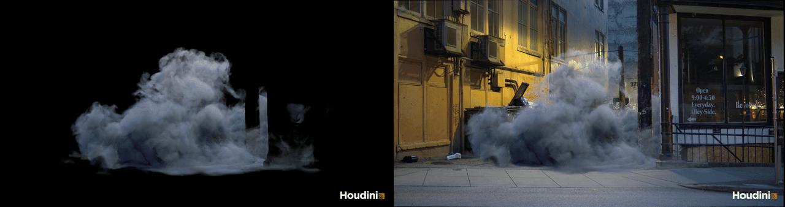

# image2point

Turn plates and a tracked camera into editable 3D point-cloud holdouts for VFX.
Built around **MoGe-3**, with generation in **ComfyUI** and adjustment and baking in **Houdini**.

[Download](https://github.com/brokenCushion/image2point/releases) · [Install](docs/install.md) · [User guide](docs/user-guide.md) · [Example workflow](docs/examples/image2point-comfyui-workflow.json)

## Why Image2Point

Dust, storms, volumes, and flying particles need to pass in front of and behind actors in a
plate. Creating those holdouts can involve full-body match animation, even when the effect
only needs an approximate representation of the actors' depth.

Image2Point explores a quicker way to create those depth proxies from the plates. It is
intended for shots where approximate geometry is useful; precise contact and detailed
occlusion may still need match animation or manual work.

## Preliminary test

A Houdini dust simulation held out by Image2Point proxies. Left: the raw Karma render.
Right: the render composited over the plate, with the dust passing behind the pole and the
dumpsters.

This shot has no actors. Further testing is needed on plates with actors.

## Powered by MoGe-3

[MoGe-3](https://qft-333.github.io/moge3page/) estimates depth from each plate. The tracked USD camera supplies lens calibration and
the camera pose, placing the points in shot space. Image2Point connects that reconstruction
to a ComfyUI workflow and an editable Houdini proxy.

## ComfyUI

Generate point clouds from a plate sequence and tracked camera, with optional roto for actor
regions. Preview the result in ComfyUI and take the frame cache into Houdini.

**Load MoGe-3 Model** and **Generate Point Cloud:** the two Image2Point nodes, for model
selection and point-cloud generation.

[Node controls, connections, and sample setup →](docs/user-guide.md#comfyui)

## Houdini

The **Image2Point Proxy** HDA loads the frame cache from ComfyUI as a point cloud in shot
space, already lined up with the plate through the tracked camera. It steadies MoGe's
frame-to-frame depth, repairs and extends actor edges, isolates actors with their own depth
and edge settings, and bakes the result to BGEO point sequences carrying position, colour,
actor ID, point size, and roto for rendering.

**Shot space:** the colored point cloud viewed alongside a grey photogrammetry reference of
the set.

### Global

Controls for the whole point cloud: depth offset, depth stabilisation, edge treatment, point
coverage, and background removal.

**Remove Background:** removes background points, keeping only the actor regions.

### Actors

**Per-Actor Overrides:** isolate actors and tune their depth, edges, and point coverage
individually.

**Edge Repair:** adjusts unreliable depth around an actor's boundary.

**Edge Extend:** grows the point region beyond the mask boundary.

### Display

**Roto Check:** shows the supplied roto colors directly on the point cloud.

**ID Check:** shows each actor ID as a distinct color, to check the assignments.

### Bake

**Render output:** the asset's output 0 is full resolution and clean, ready for a standard
Geometry ROP and a studio farm submission node.

**Local Bake:** bakes the Render output on this machine to a typed path, for quick tests.

[Houdini controls and bake instructions →](docs/user-guide.md#houdini)

## Documentation

- [User guide](docs/user-guide.md): node reference, sample setup, Houdini controls, and development.
- [Using Image2Point](docs/usage.md): camera mapping and workflow overview.
- [Package format](docs/package-format.md): the data passed from ComfyUI to Houdini.
- [Audit sheet](docs/audit.md): model sources, licences, and security.

## Licence

[MIT](LICENSE). MoGe-3 weights and code are MIT, and MoGe's DINOv2 part is Apache-2.0.
