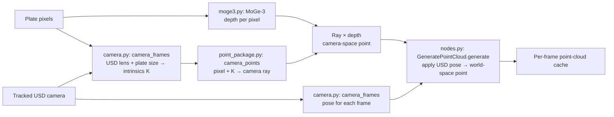

# Using Image2Point

## 1. Houdini asset

```bash
hython houdini/build_hda.py     # creates houdini/image2point_proxy.hda
hython houdini/smoke_test.py    # expect a PASS line
```

On Linux, `source houdini_setup` in the Houdini folder first. Install the asset with
**Assets → Install Asset Library**. Build it with the studio's licence: an Apprentice
licence makes a `.hdanc` that can't be used in production.

## 2. ComfyUI

Load `examples/comfyui-workflow.json`. For the sample shot, copy `sample/plate.png` into
ComfyUI's `input` folder and set the camera path to `sample/camera.usda`.

**Load MoGe-3 Model:** pick the `.pt` file. Nothing is ever downloaded.

**Generate Point Cloud** inputs:
- `plates`: sRGB images in 0–1, undistorted.
- `camera_usd`: the tracked camera. It must set FPS, units and up axis, and match the
  plate aspect. Set `camera_prim` if the file has more than one camera.
- `roto` (optional): an RGB image sequence, stored on every point as the `roto` colour
  attribute for shaders. Without tracks, its channels are the actors: **red = 1,
  green = 2, blue = 3** (a greyscale roto is actor 1).
- `actor_tracks` (optional): **SAM3_TRACK_DATA** from SAM 3 video tracking, for more
  than 3 actors. When connected, SAM gives the actor IDs instead of the roto.

Key controls:
- **Input First Frame**: the frame number of the first plate in the batch.
- **Output Resolution**: start with half or quarter.
- **Output Directory**: the package folder, on shared storage. Saved as `_v001`;
  never overwritten: new results go to `_v002`, `_v003` and so on.

The `houdini_cache` output gives the manifest path for Houdini. Re-runs in the same ComfyUI
session reuse the depth, so changing masks is quick.

### How a pixel becomes a 3D point



The plate supplies the pixel grid; USD supplies lens calibration and the animated camera
pose; MoGe-3 estimates depth. The pose places each camera-space point into shot world space.

## 3. Houdini

Create an **Image2Point Proxy** SOP and set **Point Cloud Cache**. Only the bake range
follows the cache; studio scene FPS and timeline stay unchanged. FPS must match the cache.
Leave the object transform at identity: the points are already in
world space.

- **Depth Offset:** moves points along the camera rays (negative is closer).
- **Global → Stabilisation → Stabilize Depth** (on by default): removes MoGe's
  frame-to-frame depth "breathing" by matching each frame's scale to its neighbours,
  measured on the static background. The first cook reads every frame once (about 25 s
  for 100 frames at 2K).
- **Global → Stabilisation → Background Smoothing (frames):** averages the static set
  with this many frames each side to calm surface shimmer. 0 (default) is off; each step
  adds about 1 s per frame at 2K.
- **Edge Repair / Edge Extend:** repairs depth using the actor interior or grows geometry outward, in grid pixels.
- **Actors → Depth Tolerance:** fixes stray edge points far from the actor's depth.
  Edge Repair and Edge Extend start at 1. Tolerance starts at 0: it flattens actors that span a
  long depth.
- **Point Coverage:** point size (`pscale`).
- **Global → Remove Background:** keeps actors only.
- **Display → Roto Check:** shows roto as point colour, not opacity; black points remain visible.
- **Display → ID Check:** one colour per actor, background grey. Both checks are viewport
  only; bakes keep the plate colour.
- **Actors → Per-Actor Overrides:** settings per actor ID (a new row takes the next
  unused ID). Once any row exists, only actors with a row are shown; untick **Keep**
  to drop one. **Depth Smoothing (frames)** steadies that actor's overall depth over time
  (0 = off); keep it low for fast movement toward or away from camera.
- **Bake Locally:** writes `points.####.bgeo.sc` and `manifest.json` directly into
  Publish Directory, with per-frame progress and cancellation. Existing cache files
  are not overwritten; choose another folder for a new bake.
- **Prepare Farm Job:** saves a job to run with `hython farm_bake.py <job.json>`.

Point attributes: `P`, `Cd`, `object_id` (0 = background), `pscale`, `uv`,
`source_pixel`, and `roto` when a roto was connected.

## Not yet validated

Linux, the studio farm, RenderMan (a point material using `roto` as opacity), and
production shots at full 4K.
