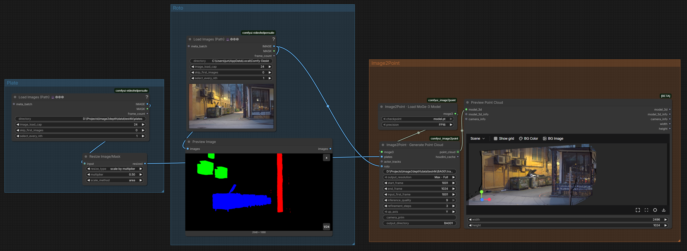
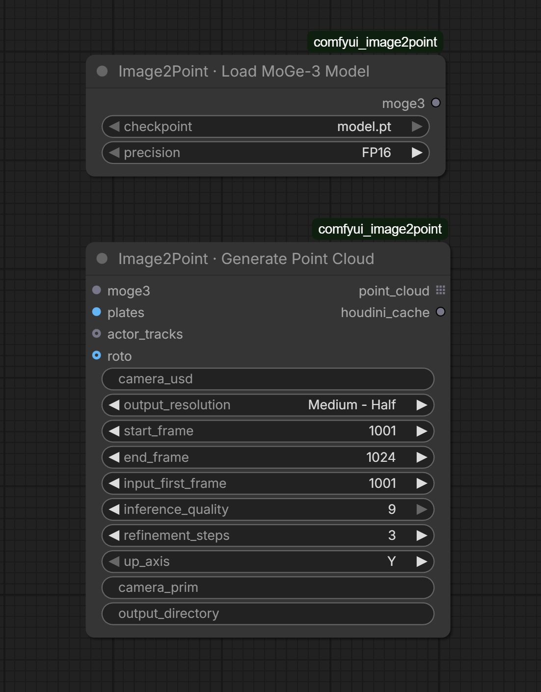
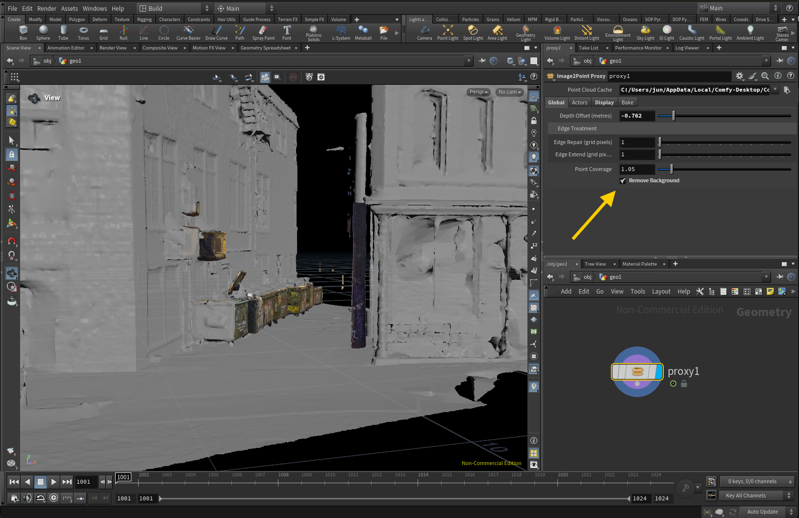
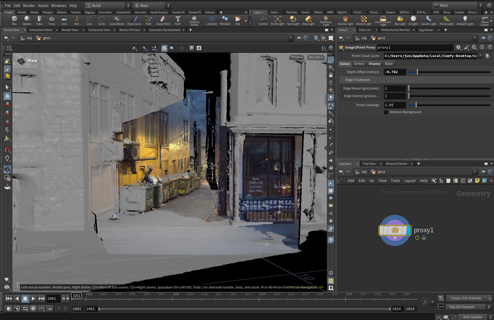
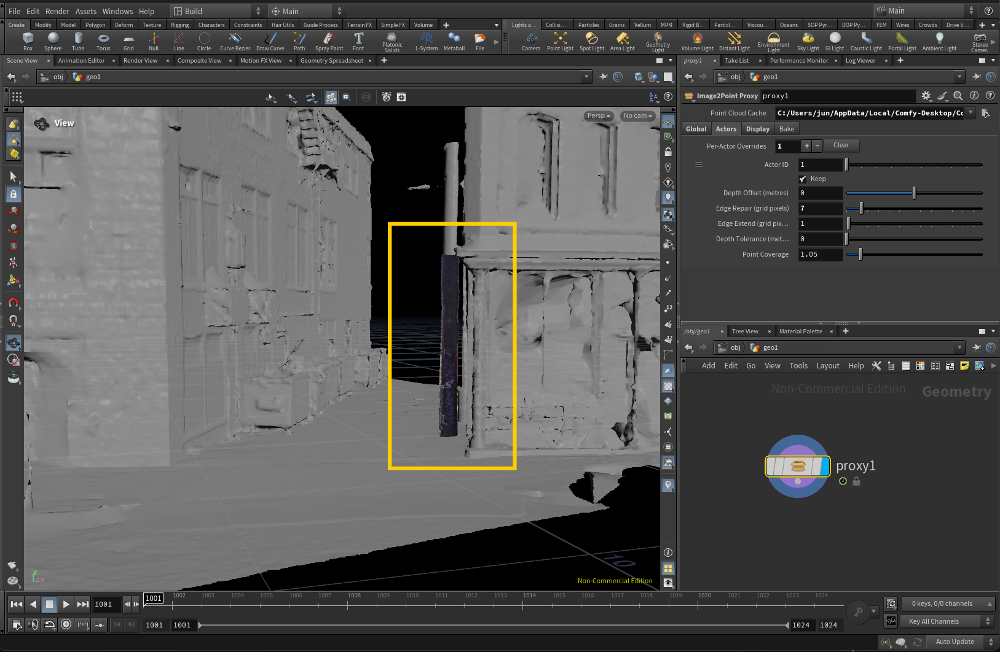
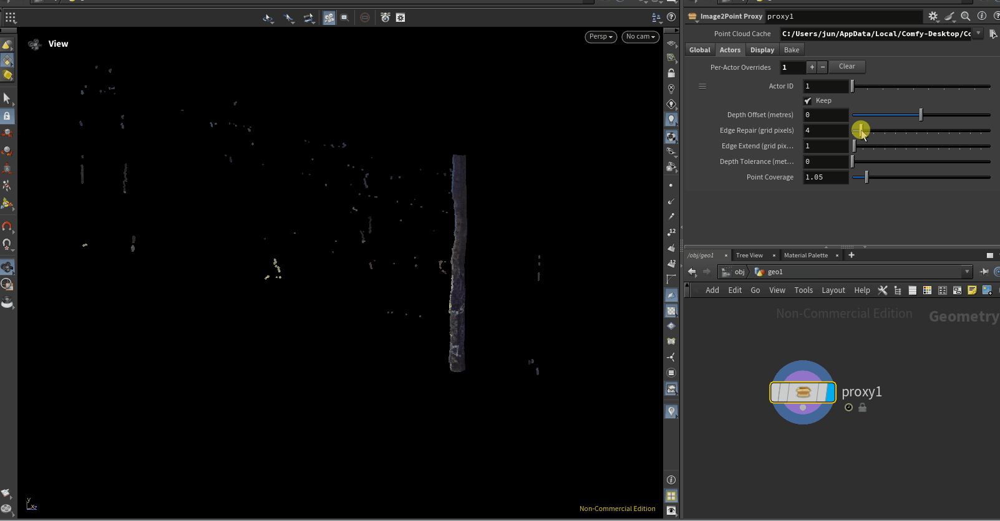
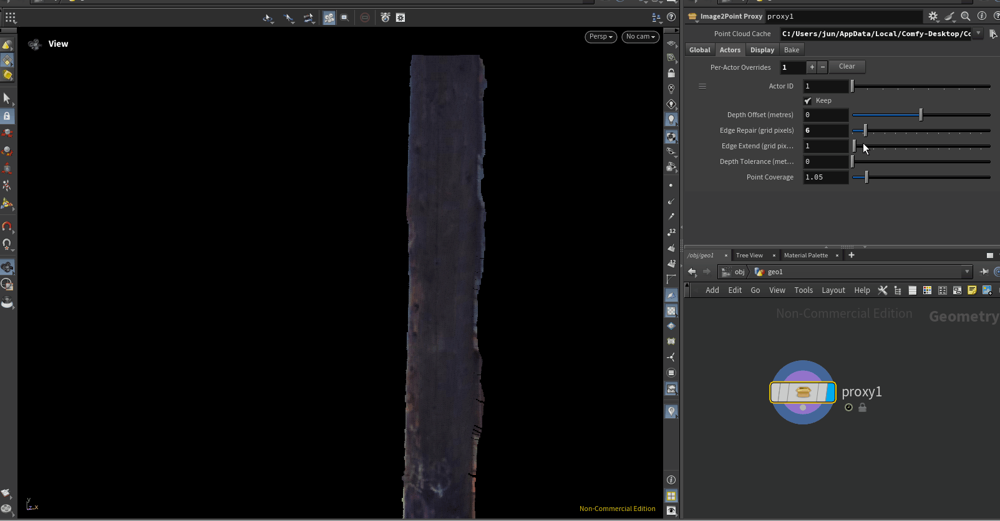
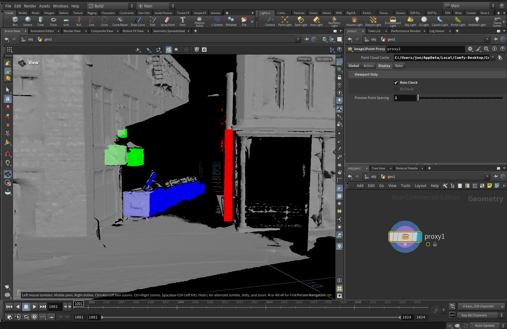
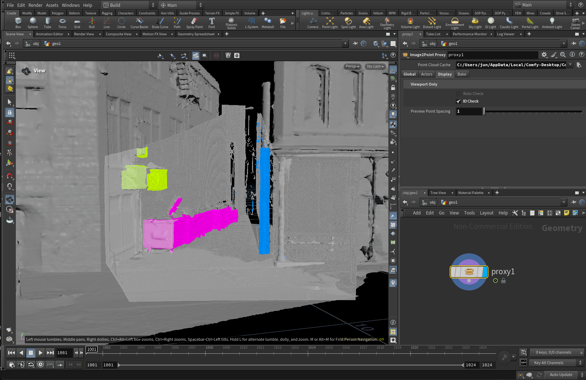

# Image2Point User Guide

[Back to the feature showcase](../README.md) · [Installation](install.md)

## ComfyUI

Generate a point-cloud preview and Houdini cache from plate frames and a tracked USD camera.

### Example workflow

The graph below shows a plate sequence, an RGB roto sequence, the Image2Point nodes, and a
point-cloud preview. The plate branch is resized to half before it reaches Image2Point, so
`Max - Full` uses the full resolution of that resized input. The roto branch is connected
to `roto`; `actor_tracks` is left unconnected, so the roto's red, green, and blue channels
define actor IDs.



[Download the example workflow JSON](examples/image2point-comfyui-workflow.json). It uses
VideoHelperSuite's Load Images (Path) node, a Resize Image/Mask node, and Preview Point
Cloud. Replace the `PATH/TO/...` values with paths on your computer before running it.

### Node controls



### Load MoGe-3 Model

Choose the local MoGe-3 checkpoint and the precision used when the model runs. The node
checks the checkpoint and passes its settings to Generate Point Cloud; it does not create
the point cloud by itself.

| Socket or control | What it does |
| --- | --- |
| `checkpoint` | Selects a local MoGe-3 `.pt` checkpoint. The node does not download model files. |
| `precision` | `FP16` uses less GPU memory and is usually faster; `FP32` uses full precision and may use more memory. |
| `moge3` output | Connects the loaded model settings to Generate Point Cloud. |

### Generate Point Cloud

Connect the model, plate frames, and tracked camera. Set the frame range and output options,
then run the node. It estimates depth, places points using the USD camera, and saves a
versioned package containing the Houdini cache and PLY files.

#### Inputs

| Socket | Required? | What to connect |
| --- | --- | --- |
| `moge3` | Yes | The `moge3` output from Load MoGe-3 Model. |
| `plates` | Yes | An RGB `IMAGE` batch in display-ready sRGB, with values from 0 to 1. The batch order must match the frame numbering below. |
| `actor_tracks` | No | SAM 3 video tracking data. When connected, its masks and tracking slots provide actor IDs; `roto` can still provide the roto colour attribute. |
| `roto` | No | An RGB roto image batch matching the plates in frame count and image size. With SAM tracks, it is saved as the `roto` point attribute. Without SAM tracks, its channels also define actors: red is ID 1, green ID 2, blue ID 3; a greyscale roto is ID 1. Pixels below the 0.5 mask threshold are background. |

#### Controls

| Control | Default | What it does |
| --- | --- | --- |
| `camera_usd` | Empty | Path to the tracked USD camera file. The camera must include FPS metadata, use matching FPS and time codes, and match the plate aspect ratio. |
| `output_resolution` | Medium - Half | Sets the point grid and MoGe inference resolution relative to the plate: `Max - Full` (1×), `Medium - Half` (½), `Low - Quarter` (¼), or `Draft - Eighth` (⅛). Lower settings create fewer points and use less compute. |
| `start_frame` | 1001 | First shot frame to generate. |
| `end_frame` | 1024 | Last shot frame to generate, inclusive. |
| `input_first_frame` | 1001 | Shot frame number represented by the first image in the `plates` batch. For example, if the batch starts at frame 1001, keep this at 1001 even when generating only a later part of the shot. |
| `inference_quality` | 9 | MoGe-3 quality setting from 0 to 9. |
| `refinement_steps` | 3 | MoGe-3 refinement count from 0 to 16. Higher is not always better. |
| `up_axis` | Y | Sets the package coordinate convention to Y-up or Z-up. Match the intended Houdini scene convention. |
| `camera_prim` | Empty | USD camera prim path. Leave blank when the USD contains exactly one camera; specify a prim when it contains multiple cameras. |
| `output_path` | Not connected | Optional input socket. Connect a path without a file extension, for example from a pipeline naming node. Image2Point then writes `<path>.####.npz`, `<path>.####.ply` and `<path>.manifest.json` as given, with no versioning of its own, and ignores `output_directory`. Running again with identical results reuses the files; different results at the same path are refused. |
| `output_directory` | Empty | Optional package folder. An absolute path uses that location; a plain name goes under ComfyUI's output folder. Packages are versioned (`_v001`, `_v002`, and so on) and existing results are not overwritten. Leave blank for an automatic folder under `ComfyUI/output/image2point`. |

#### Outputs

| Socket | Type | What it contains |
| --- | --- | --- |
| `point_cloud` | `FILE_3D_PLY` list | One PLY file per generated frame. Connect it to ComfyUI's Preview Point Cloud or a compatible 3D save node. |
| `houdini_cache` | String | The path to the package's manifest (`manifest.json`, or `<path>.manifest.json` with `output_path`). Use this path in Houdini's Point Cloud Cache parameter. The manifest describes the per-frame NPZ cache and camera data. |

The PLY files are for ComfyUI preview and compatible 3D nodes. Houdini reads the manifest
and NPZ frame files from the same package. Keep the package together when moving it to
shared storage.

### Typical connections

1. Connect Load MoGe-3 Model's `moge3` output to Generate Point Cloud's `moge3` input.
2. Connect the plate image batch to `plates` and the tracked camera file to `camera_usd`.
3. Optionally connect SAM tracking data to `actor_tracks` and/or an RGB matte to `roto`.
4. Set the frame mapping and output folder, then run Generate Point Cloud.
5. Connect `point_cloud` to Preview Point Cloud to inspect the result. In Houdini, set the
   HDA's Point Cloud Cache to the `houdini_cache` manifest path.

For the cache layout and per-frame attributes, see [Package Format](package-format.md).

### Set up the supplied sample files

Extract `I2P_sample.zip` and `tempMask.zip`. Point the plate loader to
`I2P_sample/jpg` and set its image load cap to 24. Set `camera_usd` to
`I2P_sample/BA001.track.v02.usd`; use frames 1001–1024, set `input_first_frame` to 1001,
and choose Z for `up_axis`. The camera has one camera prim, so `camera_prim` can stay
blank. The supplied camera is 24 FPS, Z-up, and measured in meters. Its full range is
1001–1100; the 24 supplied plates cover 1001–1024.

The ZIP also contains `set_cleanedQuad_v03.obj`, which this ComfyUI workflow does not use.
The `tempMask` folder from `tempMask.zip` contains 24 RGB roto frames at 2048 × 1080,
matching the plate branch after its half-size resize. Point the Roto Load Images (Path) node
to that folder and connect its `IMAGE` output to `roto`. Its red, green, and blue regions
become actor IDs 1, 2, and 3; black is background. Leave `actor_tracks` unconnected. The
first roto image corresponds to plate frame 1001, as set by `input_first_frame`.

## Houdini

Image2Point turns the per-frame point-cloud cache into an editable Houdini proxy. This guide
follows the Image2Point Proxy tabs in order: **Global**, **Actors**, **Display**, and
**Local Bake**.
The screenshots and clips illustrate one sample scene; they are not quality guarantees.

Set **Point Cloud Cache** to the manifest path returned by Generate Point Cloud's
`houdini_cache` output. The manifest points to the frame data and camera information.

**Outputs and the farm.** The asset has two outputs:

- **Output 0, Render:** full resolution with plate colours, never the viewport checks. Geometry
  ROPs and Local Bake write this.
- **Output 1, Preview:** Preview Point Spacing plus Roto Check and ID Check, for the viewport.

```
/obj/geo1:  Image2Point Proxy ─ output 0 ─▶ RENDER (Null, render flag)
                              └ output 1 ─▶ PREVIEW (Null, display flag)
/out:       Geometry ROP (SOP Path → RENDER) ─▶ studio farm submission node
```

The viewport cooks only the Preview, so the full-resolution Render is computed only when a ROP
or Local Bake asks for it. Farm machines need `image2point_proxy.hda` on their asset path.

### Global

Global controls apply to the point cloud as a whole.

**Depth Offset** moves points along the camera rays. The **Stabilisation** group has two
controls. **Stabilize Depth** (on by default) removes the frame-to-frame depth "breathing"
MoGe produces, because it guesses each frame's scale on its own: each frame is matched to
its neighbours using the static background, then moved along the camera rays, so plate
alignment is kept. **Background Smoothing** (off by default) averages the static set with
neighbouring frames to calm fine surface shimmer, at the cost of slower cooks. **Edge Repair** fills unreliable depth
near actor boundaries using nearby interior depth, while **Edge Extend** grows the point region
outward from the actor mask. Both edge controls use grid pixels, so their world-space effect
depends on the point-grid resolution. **Point Coverage** controls the point size. **Remove
Background** excludes points assigned to the background ID.



The comparison below shows the Image2Point result in a scene with a photogrammetry reference.
Use it to inspect alignment and broad shape; the two methods have different inputs, so this is
not a controlled quality comparison.



### Actors

The **Actors** tab lets you add an override row for an actor ID. Each row can keep or drop that
actor and adjust its depth offset, edge repair, edge extension, depth tolerance, and point
coverage independently. Once override rows exist, only actors with a row are kept; turn off
**Keep** to exclude a listed actor. **Depth Smoothing** steadies the actor's overall depth over
time; it does not steady the actor's shape, and high values soften fast movement toward or
away from camera.



The clips below show the effect of changing an actor's edge repair and edge extension:





### Display

Display checks help inspect masks and actor assignments in the viewport. They affect only
the Preview output (output 1); the Render output and every bake keep the plate colors.

**Roto Check** shows roto colors on points. In this example, green, blue, and red identify the
three roto regions.



**ID Check** colors points by actor ID. The colored regions help show how separate objects have
been assigned; the background appears grey.



### Local Bake

For quick tests on this machine. Type an **Output File** with a frame number, for example
`$HIP/test/points.$F4.bgeo.sc`, choose inclusive start and end frames, and press **Bake
Locally**. It writes the Render output, prepares frames in parallel, and overwrites existing
files like a Geometry ROP. For the farm, connect a Geometry ROP on the Render output to the
studio's submission node instead (see Outputs and the farm above).

See [Using Image2Point](usage.md) for setup and bake behavior.

## Development

```bash
python -m venv .venv
source .venv/bin/activate
python -m pip install torch==2.8.0 torchvision==0.23.0 --index-url https://download.pytorch.org/whl/cu128
python -m pip install -e ".[dev]"
python -m pytest
python -m ruff check && python -m ruff format --check
python tools/build_release.py     # builds dist/image2point-<version>.zip
```

On Windows, activate the environment with `.venv\Scripts\activate` instead.

GPU tests need the MoGe source and weights in `cache/MoGe` (pins in the
[audit sheet](audit.md)). GPU and Houdini tests skip themselves when CUDA, the
weights or `hython` are missing.

